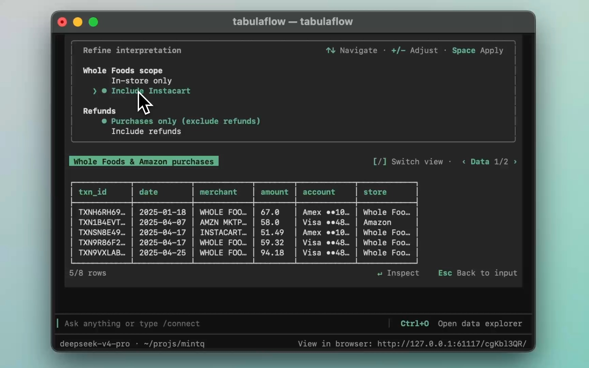
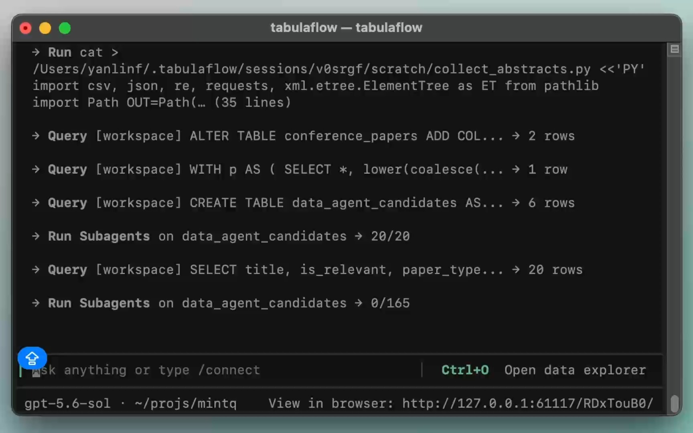
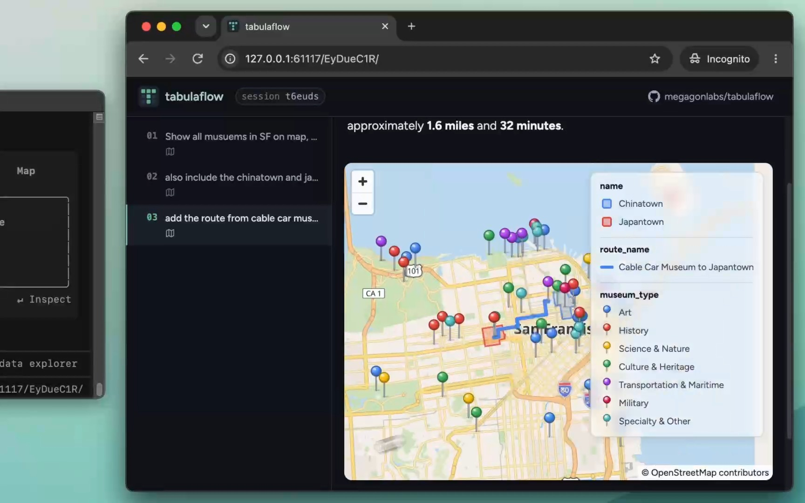
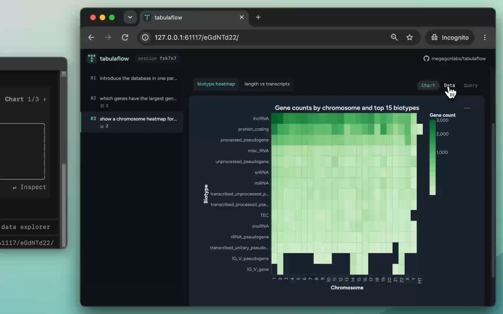
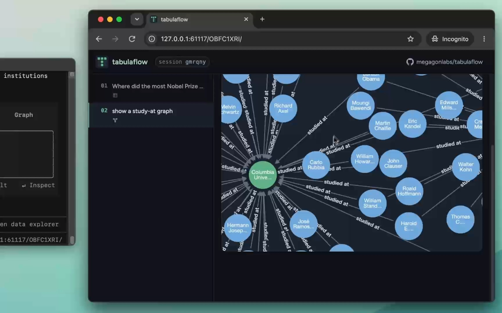
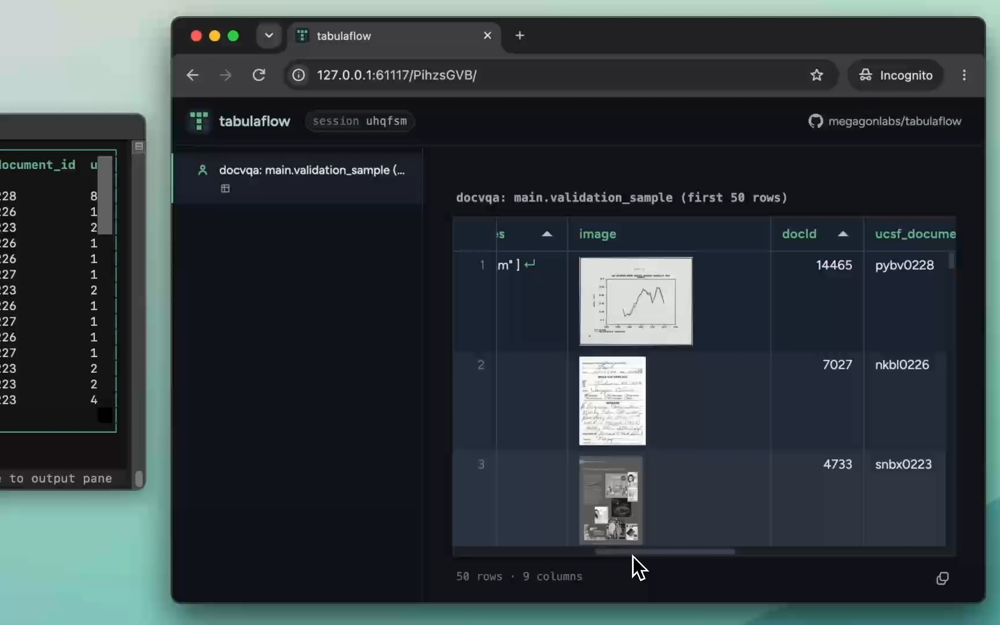

---
hide:
  - toc
---

# General-purpose data agent

TabulaFlow is an open-source data agent application, as well as a library for building data agents.

Think of it as Claude Code for data: describe in natural language what you want
to analyze, visualize, or transform. It works with all kinds of data, including
SQL and graph databases, files, Hugging Face datasets, Wikidata, and web pages.
You can also browse data directly without an LLM or use it like a coding agent to write code
or handle everyday tasks.

<div class="landing-showcase-wrap">
<div class="landing-showcase">
  <div class="landing-showcase__panel landing-showcase__application">
    <div class="landing-showcase__title">Use the application</div>
    <div class="demo-gallery" id="demo-gallery">
      <span class="demo-gallery__anchor" id="demo-disambiguation" data-tab-id="demo-tab-disambiguation" aria-hidden="true"></span>
      <span class="demo-gallery__anchor" id="demo-research" data-tab-id="demo-tab-research" aria-hidden="true"></span>
      <span class="demo-gallery__anchor" id="demo-travel" data-tab-id="demo-tab-travel" aria-hidden="true"></span>
      <span class="demo-gallery__anchor" id="demo-database" data-tab-id="demo-tab-database" aria-hidden="true"></span>
      <span class="demo-gallery__anchor" id="demo-wikidata" data-tab-id="demo-tab-wikidata" aria-hidden="true"></span>
      <span class="demo-gallery__anchor" id="demo-hugging-face" data-tab-id="demo-tab-hugging-face" aria-hidden="true"></span>
      <div class="demo-gallery__tabs" role="group" aria-label="TabulaFlow demos">
        <button type="button" class="demo-gallery__choice" aria-haspopup="dialog" aria-controls="demo-dialog" id="demo-tab-disambiguation" aria-label="Play Get Precise Data via Interactive Disambiguation" data-anchor-id="demo-disambiguation"
          data-title="Get Precise Data via Interactive Disambiguation"
          data-description="Resolve an ambiguous question with an interactive, parameterized visualization."
          data-type="Structured disambiguation"
          data-poster="assets/demos/structured-disambiguation-poster.jpg"
          data-video-src="assets/demos/structured-disambiguation.mp4">
          
          <span>Interactive disambiguation</span>
        </button>
        <button type="button" class="demo-gallery__choice" aria-haspopup="dialog" aria-controls="demo-dialog" id="demo-tab-research" aria-label="Play Build a Research Paper Database" data-anchor-id="demo-research"
          data-title="Build a Research Paper Database"
          data-description="Build a comprehensive, structured database of conference papers on a research topic."
          data-type="Research workflow"
          data-poster="assets/demos/find-research-papers-poster.jpg"
          data-video-src="assets/demos/find-research-papers.mp4">
          
          <span>Deep research</span>
        </button>
        <button type="button" class="demo-gallery__choice" aria-haspopup="dialog" aria-controls="demo-dialog" id="demo-tab-travel" aria-label="Play Plan a Trip on a Map" data-anchor-id="demo-travel"
          data-title="Plan a trip on a map"
          data-description="Find museums, add neighborhood boundaries, and map a walking route."
          data-type="Mapping workflow"
          data-poster="assets/demos/plan-a-trip-on-a-map-poster.jpg"
          data-video-src="assets/demos/plan-a-trip-on-a-map.mp4">
          
          <span>Plan a trip on a map</span>
        </button>
        <button type="button" class="demo-gallery__choice" aria-haspopup="dialog" aria-controls="demo-dialog" id="demo-tab-database" aria-label="Play Chat to a Bioinformatics MySQL db" data-anchor-id="demo-database"
          data-title="Chat to a Bioinformatics MySQL db"
          data-description="Connect a bioinformatics MySQL database and ask TabulaFlow to introduce and explore it."
          data-type="Database workflow"
          data-poster="assets/demos/chat-to-a-database-poster.jpg"
          data-video-src="assets/demos/chat-to-a-database.mp4">
          
          <span>Analyze a bioinformatics mysql db</span>
        </button>
        <button type="button" class="demo-gallery__choice" aria-haspopup="dialog" aria-controls="demo-dialog" id="demo-tab-wikidata" aria-label="Play Query and Visualize Graphs" data-anchor-id="demo-wikidata"
          data-title="Query and Visualize Graphs"
          data-description="Ask a knowledge-graph question, inspect the results, and explore their relationships."
          data-type="Knowledge graph workflow"
          data-poster="assets/demos/query-wikidata-poster.jpg"
          data-video-src="assets/demos/query-wikidata.mp4">
          
          <span>Wikidata and graphs</span>
        </button>
        <button type="button" class="demo-gallery__choice" aria-haspopup="dialog" aria-controls="demo-dialog" id="demo-tab-hugging-face" aria-label="Play Explore a Multimodal Hugging Face Dataset" data-anchor-id="demo-hugging-face"
          data-title="Explore a multimodal Hugging Face dataset"
          data-description="Connect a multimodal Hugging Face dataset and explore its schema, rows, and media."
          data-type="Data browsing workflow"
          data-poster="assets/demos/explore-a-multimodal-hugging-face-dataset-poster.jpg"
          data-video-src="assets/demos/explore-a-multimodal-hugging-face-dataset.mp4">
          
          <span>Browse media in tables</span>
        </button>
      </div>
      <dialog class="demo-gallery__dialog" id="demo-dialog" aria-label="Demo video">
        <button class="demo-gallery__dialog-close" type="button" aria-label="Close demo">
          <svg viewBox="0 0 24 24" aria-hidden="true"><path d="m6 6 12 12M18 6 6 18"></path></svg>
        </button>
        <video class="demo-gallery__dialog-video" controls playsinline preload="metadata"></video>
      </dialog>
    </div>
  </div>
  <div class="landing-showcase__panel landing-showcase__code" markdown="1">
    <div class="landing-showcase__title">Build with Python library</div>
    <div class="code-showcase">
      <div class="code-showcase__tabs demo-gallery__tabs" role="tablist" aria-label="Python examples">
        <button type="button" role="tab" id="code-tab-agent" aria-controls="code-panel-agent" aria-selected="true">Query &amp; visualize</button>
        <button type="button" role="tab" id="code-tab-enrichment" aria-controls="code-panel-enrichment" aria-selected="false" tabindex="-1">Row-wise enrichment</button>
      </div>
      <div class="code-showcase__panel" id="code-panel-agent" role="tabpanel" aria-labelledby="code-tab-agent" markdown="1">

    ```python
    from tabulaflow.agents import ChatSession
    from tabulaflow.data import DataConnectorRegistry, SQLConnector

    async with DataConnectorRegistry() as registry:
        sales = await SQLConnector.from_url_async("sqlite:///sales.db")
        support = await SQLConnector.from_url_async("sqlite:///support.db")
        registry.register("sales", sales)
        registry.register("support", support)

        async with ChatSession(
            registry=registry, model="openai:gpt-5.6-sol", reasoning="low"
        ) as session:
            result = await session.run(
                "Join sales and support by customer ID. Compare revenue with open "
                "high-priority tickets as a table and revenue as a bar chart."
            )

    answer = result.text
    table, chart = result.output.artifacts
    ```

      <a class="code-showcase__example-link" href="library/quick-start/#example-chat-with-two-data-sources" aria-label="View the full agent example">Full example →</a>
      </div>
      <div class="code-showcase__panel" id="code-panel-enrichment" role="tabpanel" aria-labelledby="code-tab-enrichment" markdown="1" hidden>

    ```python
    import pandas as pd
    from pydantic import BaseModel
    from tabulaflow.agents.enrichment import DataFrameEnricher

    class JobDetails(BaseModel):
        business_domain: str | None = None
        work_mode: str | None = None
        min_experience_years: int | None = None

    jobs = pd.DataFrame([
        {"title": "Data Analyst", "description": "Analyze retail sales data."},
        # Additional rows...
    ])

    enriched = await DataFrameEnricher(enable_browser_tools=False).enrich(
        jobs,
        record_type=JobDetails,
        instruction=(
            "Extract business domain, work mode, and minimum experience "
            "from {{ title }}: {{ description }}"
        ),
    )
    ```

      <a class="code-showcase__example-link" href="library/extraction-and-enrichment/#example-find-jobs-that-fit" aria-label="View the full enrichment example">Full example →</a>
      </div>
    </div>
  </div>
</div>
</div>

Unlike existing coding-agent harnesses that are built around files and the
shell, TabulaFlow treats tables as first-class citizens, as its name suggests.
Its core harness is **shell-independent**, making it particularly suitable for building data applications without requiring sandboxes.
[Compare token efficiency](#how-does-tabulaflow-work){ .inline-cta }

## Data agent patterns

<div class="tf-patterns">
  <svg class="svg-symbols" aria-hidden="true" focusable="false">
    <defs>
      <symbol id="tf-pattern-document-stack" viewBox="0 0 54 54">
        <g transform="rotate(-3 22 29)">
          <rect fill="#1a212c" stroke="#465365" stroke-linejoin="round" stroke-width="1.5" x="3.5" y="5.5" width="38" height="46" rx="5"></rect>
          <path fill="none" stroke="#556171" stroke-linecap="round" stroke-width="3" d="M11.5 21h21M11.5 29h21"></path>
        </g>
        <g transform="rotate(3 32 25)">
          <rect fill="#1a212c" stroke="#465365" stroke-linejoin="round" stroke-width="1.5" x="12.5" y="1.5" width="38" height="46" rx="5"></rect>
          <path fill="none" stroke="#556171" stroke-linecap="round" stroke-width="3" d="M20.5 17h21M20.5 25h21"></path>
        </g>
      </symbol>
      <symbol id="tf-pattern-viz-chart" viewBox="10 5 32 32">
        <rect x="14" y="26" width="5" height="7" rx="1" fill="#8298ad" stroke="none"></rect>
        <rect x="23" y="20" width="5" height="13" rx="1" fill="#8298ad" stroke="none"></rect>
        <rect x="32" y="23" width="5" height="10" rx="1" fill="#8298ad" stroke="none"></rect>
        <path d="M14 20l9-6 8 3 8-8" stroke="#5faf87" stroke-width="2"></path>
        <circle cx="14" cy="20" r="1.7" fill="#5faf87" stroke="none"></circle>
        <circle cx="23" cy="14" r="1.7" fill="#5faf87" stroke="none"></circle>
        <circle cx="31" cy="17" r="1.7" fill="#5faf87" stroke="none"></circle>
        <circle cx="39" cy="9" r="1.7" fill="#5faf87" stroke="none"></circle>
      </symbol>
      <symbol id="tf-pattern-viz-map" viewBox="5 5 38 38">
        <path d="M8 13l11-5 9 5 12-3v25l-12 5-9-5-11 3z" fill="#293b50" stroke="#8298ad"></path>
        <path d="M8 13l11-5 9 5 12-3v25l-12 5-9-5-11 3zM19 8v27M28 13v27" stroke="#8298ad"></path>
        <g transform="translate(14 14)">
          <path d="M0 0c-3 0-5 2.2-5 5 0 3.8 5 8 5 8s5-4.2 5-8c0-2.8-2-5-5-5z" fill="#5faf87" stroke="none"></path>
          <circle cx="0" cy="5" r="1.6" fill="#202733" stroke="none"></circle>
        </g>
        <g transform="translate(33 20)">
          <path d="M0 0c-3 0-5 2.2-5 5 0 3.8 5 8 5 8s5-4.2 5-8c0-2.8-2-5-5-5z" fill="#5faf87" stroke="none"></path>
          <circle cx="0" cy="5" r="1.6" fill="#202733" stroke="none"></circle>
        </g>
      </symbol>
      <symbol id="tf-pattern-viz-graph" viewBox="0 0 28 28">
        <g stroke="#8298ad" stroke-width="0.9">
          <path d="M14 14 12 4M14 14 23 8M14 14 23 21M14 14 10 24M14 14 4 16M12 4 23 8"></path>
          <circle cx="14" cy="14" r="3.2" fill="#8298ad" stroke="none"></circle>
          <circle cx="12" cy="4" r="2.1" fill="#202733"></circle>
          <circle cx="23" cy="8" r="2.1" fill="#202733"></circle>
          <circle cx="23" cy="21" r="2.1" fill="#202733"></circle>
          <circle cx="10" cy="24" r="2.1" fill="#202733"></circle>
          <circle cx="4" cy="16" r="2.1" fill="#202733"></circle>
        </g>
      </symbol>
    </defs>
  </svg>

  <table class="patterns-table" aria-label="Data agent patterns and their data flows">
    <colgroup>
      <col class="pattern-column">
      <col class="flow-column">
    </colgroup>
    <tbody>
      <tr>
        <th scope="row">
          <span class="pattern-title">Text-to-query</span>
          <span class="pattern-description">Turn natural-language requests into query-backed data tables.</span>
          <span class="pattern-links">
            <a class="resource-pill resource-pill--demo" href="#demo-database" aria-label="Watch the MySQL chat demo">Chat with MySQL</a>
            <a class="resource-pill resource-pill--code" href="library/quick-start/#example-chat-with-two-data-sources" aria-label="View the chat agent Python example">Build a chat agent</a>
          </span>
        </th>
        <td class="diagram-cell">
          <div class="flow flow--query" role="img" aria-label="A natural-language question becomes a database query and then a table of rows.">
            <div class="flow-node question-bubble">Revenue by customer</div>
            <div class="artifact-connector" aria-hidden="true">
              <div class="spec-card">
                <span class="spec-caption">query</span>
                <svg class="spec-sheet query-sheet" viewBox="0 0 34 42" focusable="false">
                  <rect x=".75" y=".75" width="32.5" height="40.5" rx="4"></rect>
                  <text x="8" y="14">SELECT</text>
                  <path d="M8 22h18M8 27h18M8 32h12"></path>
                </svg>
              </div>
              <svg class="pattern-flow-arrow" viewBox="0 0 72 16" focusable="false"><path d="M5 8h62M58 2l9 6-9 6"></path></svg>
            </div>
            <div class="table-output" aria-hidden="true">
              <div class="mini-table">
                <span></span><span></span><span></span>
                <span></span><span></span><span></span>
                <span></span><span></span><span></span>
                <span></span><span></span><span></span>
              </div>
            </div>
          </div>
        </td>
      </tr>

      <tr>
        <th scope="row">
          <span class="pattern-title">Data-bound visualization</span>
          <span class="pattern-description">Turn data tables into charts, maps, and graphs that stay linked to their data.</span>
          <span class="pattern-links">
            <a class="resource-pill resource-pill--demo" href="#demo-travel" aria-label="Watch the trip-planning map demo">Plan a trip</a>
            <a class="resource-pill resource-pill--demo" href="#demo-wikidata" aria-label="Watch the Wikidata graph visualization demo">Visualize Wikidata</a>
            <a class="resource-pill resource-pill--code" href="library/structured-outputs/#example-warehouse-transfer-graph" aria-label="View the graph artifacts Python example">Define a graph</a>
          </span>
        </th>
        <td class="diagram-cell">
          <div class="flow flow--visualization" role="img" aria-label="A queryable table and a declarative specification become a chart, map, or graph while remaining linked to the underlying data.">
            <div class="visualization-table visualization-table--three" aria-hidden="true">
              <span class="table-header-cell"></span><span class="table-header-cell"></span><span class="table-header-cell"></span>
              <span></span><span></span><span></span>
              <span></span><span></span><span></span>
              <span></span><span></span><span></span>
            </div>
            <div class="artifact-connector" aria-hidden="true">
              <div class="spec-card">
                <span class="spec-caption">visualization spec</span>
                <svg class="spec-sheet" viewBox="0 0 34 42" focusable="false">
                  <rect x=".75" y=".75" width="32.5" height="40.5" rx="4"></rect>
                  <path class="spec-code" d="M12 9h-1c-2 0-2 2-2 3s-1 2-2 2c1 0 2 1 2 2s0 3 2 3h1M22 9h1c2 0 2 2 2 3s1 2 2 2c-1 0-2 1-2 2s0 3-2 3h-1"></path>
                  <path d="M8 27h18M8 32h12"></path>
                </svg>
              </div>
              <svg class="pattern-flow-arrow" viewBox="0 0 72 16" focusable="false"><path d="M5 8h62M58 2l9 6-9 6"></path></svg>
            </div>
            <div class="view-stack view-stack--grid" aria-hidden="true">
              <span class="view-card"><svg><use xlink:href="#tf-pattern-viz-chart"></use></svg></span>
              <span class="view-card"><svg><use xlink:href="#tf-pattern-viz-map"></use></svg></span>
              <span class="view-card"><svg><use xlink:href="#tf-pattern-viz-graph"></use></svg></span>
            </div>
          </div>
        </td>
      </tr>

      <tr>
        <th scope="row">
          <span class="pattern-title">Interactive dashboard</span>
          <span class="pattern-description">Create tables and visualizations with shared controls that update their data, including <a href="https://arxiv.org/pdf/2610.09396">structured disambiguation</a> for ambiguous questions.</span>
          <span class="pattern-links">
            <a class="resource-pill resource-pill--demo" href="#demo-disambiguation" aria-label="Watch the interactive disambiguation demo">Resolve ambiguity</a>
            <a class="resource-pill resource-pill--code" href="library/structured-outputs/#add-interactive-controls" aria-label="View the interactive controls Python example">Add controls</a>
          </span>
        </th>
        <td class="diagram-cell">
          <div class="flow flow--dashboard" role="img" aria-label="Shared controls for Gross or Net revenue and a minimum revenue slider set to ten thousand dollars update two two-by-two tables and chart, map, and graph views backed by parameterized queries.">
            <div class="dashboard-result" aria-hidden="true">
              <div class="control-panel">
                <div class="radio-options"><span class="radio-option selected">Gross revenue</span><span class="radio-option">Net revenue</span></div>
                <div>
                  <div class="range-label"><span>Minimum</span><span class="range-value">$10k</span></div>
                  <div class="range-control"></div>
                </div>
              </div>
              <svg class="control-flow-arrow" viewBox="0 0 64 104" preserveAspectRatio="none" aria-hidden="true" focusable="false">
                <path class="control-flow-line" d="M1 52h10c12 0 12-34 25-34h12M11 52c12 0 12 27 25 27h12"></path>
                <path d="M42 11l7 7-7 7M42 72l7 7-7 7"></path>
              </svg>
              <div class="dashboard-views">
                <div class="dashboard-tables">
                  <div class="visualization-table dashboard-table">
                    <span class="table-header-cell"></span><span class="table-header-cell"></span>
                    <span></span><span></span>
                    <span></span><span></span>
                  </div>
                  <div class="visualization-table dashboard-table">
                    <span class="table-header-cell"></span><span class="table-header-cell"></span>
                    <span></span><span></span>
                    <span></span><span></span>
                  </div>
                </div>
                <div class="view-stack view-stack--row">
                  <span class="view-card"><svg><use xlink:href="#tf-pattern-viz-chart"></use></svg></span>
                  <span class="view-card"><svg><use xlink:href="#tf-pattern-viz-map"></use></svg></span>
                  <span class="view-card"><svg><use xlink:href="#tf-pattern-viz-graph"></use></svg></span>
                </div>
              </div>
            </div>
          </div>
        </td>
      </tr>

      <tr>
        <th scope="row">
          <span class="pattern-title">Extraction</span>
          <span class="pattern-description">Add rows by extracting many structured records from unstructured content that far exceeds an LLM's context window.</span>
          <span class="pattern-links">
            <a class="resource-pill resource-pill--demo" href="#demo-research" aria-label="Watch the research paper database demo">Build a paper database</a>
            <a class="resource-pill resource-pill--code" href="library/extraction-and-enrichment/#extract-records-from-documents" aria-label="View the document extraction Python example">Extract documents</a>
          </span>
        </th>
        <td class="diagram-cell">
          <div class="flow" role="img" aria-label="Unstructured sources, including documents and web pages, add two mint rows beneath one existing gray data row while the table header remains unchanged.">
            <svg class="document-stack-icon" viewBox="0 0 54 54" aria-hidden="true" focusable="false"><use xlink:href="#tf-pattern-document-stack"></use></svg>
            <svg class="pattern-flow-arrow" viewBox="0 0 48 16" aria-hidden="true" focusable="false"><path d="M1 8h42M36 2l7 6-7 6"></path></svg>
            <div class="delta-output">
              <svg class="delta-table" viewBox="0 0 88 64" preserveAspectRatio="none" aria-hidden="true" focusable="false">
                <defs>
                  <linearGradient id="tf-pattern-extraction-grid" gradientUnits="userSpaceOnUse" x1="0" y1="0" x2="0" y2="64">
                    <stop class="grid-neutral" offset="46.875%"></stop>
                    <stop class="grid-mint" offset="46.875%"></stop>
                  </linearGradient>
                </defs>
                <rect class="table-header" width="88" height="13"></rect>
                <rect class="added-region" y="30" width="88" height="34"></rect>
                <path class="table-grid" stroke="url(#tf-pattern-extraction-grid)" d="M29.5 .75V63.25M58.5 .75V63.25M.75 13H87.25M.75 47H87.25"></path>
                <path class="table-grid table-separator" d="M.75 30H87.25"></path>
                <rect class="table-outline" x=".75" y=".75" width="86.5" height="62.5" rx="6.25"></rect>
              </svg>
              <span class="delta-caption" aria-hidden="true">new rows</span>
            </div>
          </div>
        </td>
      </tr>

      <tr>
        <th scope="row">
          <span class="pattern-title">Row-wise enrichment</span>
          <span class="pattern-description">Add columns to very large tables using subagents that can browse pages and click buttons. The nested version is an instance of <a href="https://arxiv.org/pdf/2512.24601">recursive language models</a>.</span>
          <span class="pattern-links">
            <a class="resource-pill resource-pill--demo" href="#demo-research" aria-label="Watch the research paper database demo">Build a paper database</a>
            <a class="resource-pill resource-pill--code" href="library/extraction-and-enrichment/#example-find-jobs-that-fit" aria-label="View the row enrichment Python example">Enrich rows</a>
          </span>
        </th>
        <td class="diagram-cell">
          <div class="flow flow--enrichment" role="img" aria-label="Three document stacks pass through independent row agents along solid arrows, adding a new typed column highlighted in mint.">
            <div class="document-stack-group" aria-hidden="true">
              <svg class="document-stack-icon document-stack-icon--small" viewBox="0 0 54 54" focusable="false"><use xlink:href="#tf-pattern-document-stack"></use></svg>
              <svg class="document-stack-icon document-stack-icon--small" viewBox="0 0 54 54" focusable="false"><use xlink:href="#tf-pattern-document-stack"></use></svg>
              <svg class="document-stack-icon document-stack-icon--small" viewBox="0 0 54 54" focusable="false"><use xlink:href="#tf-pattern-document-stack"></use></svg>
            </div>
            <div class="enrichment-connector" aria-hidden="true">
              <span class="connector-label">row agents</span>
              <svg class="pattern-flow-arrow" viewBox="0 0 38 64" focusable="false">
                <path d="M1 9.5h3C16 9.5 16 21.5 28 21.5H36M31.5 17l4.5 4.5-4.5 4.5"></path>
                <path d="M1 38.5H36M31.5 34l4.5 4.5-4.5 4.5"></path>
                <path d="M1 67.5h3C16 67.5 16 55.5 28 55.5H36M31.5 51l4.5 4.5-4.5 4.5"></path>
              </svg>
            </div>
            <div class="delta-output delta-output--columns">
              <svg class="delta-table delta-table--columns" viewBox="0 0 116 64" preserveAspectRatio="none" aria-hidden="true" focusable="false">
                <defs>
                  <linearGradient id="tf-pattern-enrichment-grid" gradientUnits="userSpaceOnUse" x1="0" y1="0" x2="116" y2="0">
                    <stop class="grid-neutral" offset="75%"></stop>
                    <stop class="grid-mint" offset="75%"></stop>
                  </linearGradient>
                </defs>
                <rect class="table-header" width="116" height="13"></rect>
                <rect class="added-region" x="87" width="29" height="64"></rect>
                <rect class="added-header" x="87" width="29" height="13"></rect>
                <path class="table-grid" stroke="url(#tf-pattern-enrichment-grid)" d="M29 .75V63.25M58 .75V63.25M.75 13H115.25M.75 30H115.25M.75 47H115.25"></path>
                <path class="table-grid table-separator" d="M87 .75V63.25"></path>
                <rect class="table-outline" x=".75" y=".75" width="114.5" height="62.5" rx="6.25"></rect>
              </svg>
              <span class="delta-caption" aria-hidden="true">new columns</span>
            </div>
          </div>
        </td>
      </tr>

      <tr>
        <th scope="row">
          <span class="pattern-title">Cross-source join</span>
          <span class="pattern-description">Connect records across sources, even when names differ.</span>
          <span class="pattern-links">
            <a class="resource-pill resource-pill--code" href="library/quick-start/#example-chat-with-two-data-sources" aria-label="View the cross-source join Python example">Join data across systems</a>
          </span>
        </th>
        <td class="diagram-cell">
          <div class="flow" role="img" aria-label="The mint first SQL row matches the mint second Neo4j row, producing the mint first output row. The blue second SQL row matches the blue first Neo4j row, producing the blue second output row. Headers remain neutral.">
            <div class="join-sources" aria-hidden="true">
              <div class="join-source">
                <span>SQL</span>
                <div class="join-table join-table--input">
                  <span></span><span></span>
                  <span class="matched-cell"></span><span class="matched-cell"></span>
                  <span class="matched-cell--blue"></span><span class="matched-cell--blue"></span>
                </div>
              </div>
              <div class="join-source">
                <span>Neo4j</span>
                <div class="join-table join-table--input">
                  <span></span><span></span>
                  <span class="matched-cell--blue"></span><span class="matched-cell--blue"></span>
                  <span class="matched-cell"></span><span class="matched-cell"></span>
                </div>
              </div>
            </div>
            <div class="join-connector" aria-hidden="true">
              <span class="connector-label">resolve &amp; join</span>
              <svg class="pattern-flow-arrow pattern-flow-arrow--merge" viewBox="0 0 48 100" preserveAspectRatio="none" focusable="false"><path d="M1 16h5C18 16 16 50 26 50M1 84h5C18 84 16 50 26 50M26 50h17M36 44l7 6-7 6"></path></svg>
            </div>
            <div class="join-table" aria-hidden="true">
              <span></span><span></span><span></span>
              <span class="matched-cell"></span><span class="matched-cell"></span><span class="matched-cell"></span>
              <span class="matched-cell--blue"></span><span class="matched-cell--blue"></span><span class="matched-cell--blue"></span>
            </div>
          </div>
        </td>
      </tr>
    </tbody>
  </table>

</div>


## Get started

Install TabulaFlow with [`uv`](https://docs.astral.sh/uv/), set a model provider
key, and launch it:

```bash
uv tool install tabulaflow
export OPENAI_API_KEY="your-api-key"
tabulaflow
```

See [Models and providers](models.md) for Anthropic, vLLM, and other providers.

We also recommend installing Chromium to enable agent-driven web browsing:

```bash
uv tool run --from playwright playwright install chromium
```

TabulaFlow opens with bundled sample data, so you can start exploring
immediately.


## How does TabulaFlow work?

TabulaFlow's agent harness is optimized for data tasks. It handles data resolution, styling, and provenance tracking
automatically so the agent never wastes tokens embedding data values or writing HTML to create visual artifacts. It also does not require shell or filesystem access. The comparison below
shows how it creates an [interactive chart](#demo-disambiguation) alongside a typical coding-agent
harness:

<div class="trajectory-comparison" markdown="1">

<div class="trajectory-question" markdown="1">

<svg class="trajectory-question__icon" viewBox="0 0 24 24" aria-hidden="true"><path d="M20 21v-2a4 4 0 0 0-4-4H8a4 4 0 0 0-4 4v2"></path><circle cx="12" cy="7" r="4"></circle></svg>

Show an interactive chart of NYC taxi-zone counts by borough, with an
all/Manhattan-only choice control and a minimum-zone-area slider.

</div>

<div class="trajectory-columns" markdown="1">

<div class="trajectory-card trajectory-card--tabulaflow" markdown="1">

<div class="trajectory-harness-label">TabulaFlow <span class="trajectory-token-count" title="Displayed code payloads, o200k_base tokenizer">188 tokens</span></div>

<div class="trajectory-call trajectory-call--source" markdown="1">

<div class="trajectory-call__header"><svg class="trajectory-agent-icon" viewBox="0 0 24 24" aria-hidden="true"><path d="M12 4V2M9.5 2h5M7 7h10a3 3 0 0 1 3 3v6a3 3 0 0 1-3 3H7a3 3 0 0 1-3-3v-6a3 3 0 0 1 3-3Z"></path><path d="M8.5 12h.01M15.5 12h.01M9 16h6"></path></svg><code>create_parameterized_source</code><span class="trajectory-call__filename">→ S1</span></div>

<pre class="trajectory-code no-copy"><code><span class="k">SELECT</span><span class="w"> </span><span class="n">borough</span>
<span class="k">FROM</span><span class="w"> </span><span class="n">nyc_taxi_zones</span>
<span class="k">WHERE</span><span class="w"> </span><span class="n">shape_area</span><span class="w"> </span><span class="o">*</span><span class="w"> </span><span class="mi">1000000</span><span class="w"> </span><span class="o">&gt;=</span><span class="w"> </span><span class="err"></span>
<span class="err">{</span><span class="o">%</span><span class="w"> </span><span class="k">if</span><span class="w"> </span><span class="n">nyc_scope</span><span class="w"> </span><span class="o">==</span><span class="w"> </span><span class="s1">'manhattan'</span><span class="w"> </span><span class="o">%</span><span class="err">}</span>
<span class="w">  </span><span class="k">AND</span><span class="w"> </span><span class="n">borough</span><span class="w"> </span><span class="o">=</span><span class="w"> </span><span class="s1">'Manhattan'</span>
<span class="err">{</span><span class="o">%</span><span class="w"> </span><span class="n">endif</span><span class="w"> </span><span class="o">%</span><span class="err">}</span>

---

<span class="p">[{</span><span class="nt">"kind"</span><span class="p">:</span><span class="s2">"choice"</span><span class="p">,</span><span class="nt">"id"</span><span class="p">:</span><span class="s2">"nyc_scope"</span><span class="p">,</span><span class="nt">"label"</span><span class="p">:</span><span class="s2">"Borough scope"</span><span class="p">,</span><span class="nt">"choices"</span><span class="p">:[{</span><span class="nt">"id"</span><span class="p">:</span><span class="s2">"all"</span><span class="p">,</span><span class="nt">"label"</span><span class="p">:</span><span class="s2">"All boroughs"</span><span class="p">},{</span><span class="nt">"id"</span><span class="p">:</span><span class="s2">"manhattan"</span><span class="p">,</span><span class="nt">"label"</span><span class="p">:</span><span class="s2">"Manhattan only"</span><span class="p">}]},{</span><span class="nt">"kind"</span><span class="p">:</span><span class="s2">"number"</span><span class="p">,</span><span class="nt">"id"</span><span class="p">:</span><span class="s2">"nyc_min_area"</span><span class="p">,</span><span class="nt">"label"</span><span class="p">:</span><span class="s2">"Minimum zone area (×10⁻⁶ source units)"</span><span class="p">,</span><span class="nt">"min"</span><span class="p">:</span><span class="mi">0</span><span class="p">,</span><span class="nt">"max"</span><span class="p">:</span><span class="mi">1000</span><span class="p">,</span><span class="nt">"step"</span><span class="p">:</span><span class="mi">25</span><span class="p">,</span><span class="nt">"default"</span><span class="p">:</span><span class="mi">0</span><span class="p">}]</span></code></pre>

</div>

<div class="trajectory-call" markdown="1">

<div class="trajectory-call__header"><svg class="trajectory-agent-icon" viewBox="0 0 24 24" aria-hidden="true"><path d="M12 4V2M9.5 2h5M7 7h10a3 3 0 0 1 3 3v6a3 3 0 0 1-3 3H7a3 3 0 0 1-3-3v-6a3 3 0 0 1 3-3Z"></path><path d="M8.5 12h.01M15.5 12h.01M9 16h6"></path></svg><code>render_chart</code><span class="trajectory-call__filename">source=S1</span></div>

<pre class="trajectory-code no-copy"><code><span class="p">{</span>
<span class="w">  </span><span class="nt">"mark"</span><span class="p">:</span><span class="w"> </span><span class="s2">"bar"</span><span class="p">,</span>
<span class="w">  </span><span class="nt">"encoding"</span><span class="p">:</span><span class="w"> </span><span class="p">{</span>
<span class="w">    </span><span class="nt">"x"</span><span class="p">:</span><span class="w"> </span><span class="p">{</span><span class="nt">"field"</span><span class="p">:</span><span class="w"> </span><span class="s2">"borough"</span><span class="p">,</span><span class="w"> </span><span class="nt">"type"</span><span class="p">:</span><span class="w"> </span><span class="s2">"nominal"</span><span class="p">},</span>
<span class="w">    </span><span class="nt">"y"</span><span class="p">:</span><span class="w"> </span><span class="p">{</span><span class="nt">"aggregate"</span><span class="p">:</span><span class="w"> </span><span class="s2">"count"</span><span class="p">,</span><span class="w"> </span><span class="nt">"type"</span><span class="p">:</span><span class="w"> </span><span class="s2">"quantitative"</span><span class="p">}</span>
<span class="w">  </span><span class="p">}</span>
<span class="p">}</span></code></pre>

</div>

</div>

<div class="trajectory-card trajectory-card--codex" markdown="1">

<div class="trajectory-harness-label">Codex <span class="trajectory-token-count" title="Displayed code payloads, o200k_base tokenizer">2,768 tokens</span></div>

<details class="trajectory-preparation" markdown="1">
<summary><span class="trajectory-preparation__show">Show 2 tool calls</span><span class="trajectory-preparation__hide">Hide 2 tool calls</span></summary>

<div class="trajectory-call" markdown="1">

<div class="trajectory-call__header"><svg class="trajectory-agent-icon" viewBox="0 0 24 24" aria-hidden="true"><path d="M12 4V2M9.5 2h5M7 7h10a3 3 0 0 1 3 3v6a3 3 0 0 1-3 3H7a3 3 0 0 1-3-3v-6a3 3 0 0 1 3-3Z"></path><path d="M8.5 12h.01M15.5 12h.01M9 16h6"></path></svg><code>exec_command</code></div>

<pre class="trajectory-code no-copy"><code><span class="kn">import</span><span class="w"> </span><span class="nn">sqlite3</span><span class="o">,</span><span class="w"> </span><span class="nn">json</span>
<span class="n">c</span> <span class="o">=</span> <span class="n">sqlite3</span><span class="o">.</span><span class="n">connect</span><span class="p">(</span><span class="s1">'upload/sample(1).sqlite'</span><span class="p">)</span>
<span class="n">rows</span> <span class="o">=</span> <span class="n">c</span><span class="o">.</span><span class="n">execute</span><span class="p">(</span><span class="s1">'SELECT borough, shape_area FROM nyc_taxi_zones WHERE borough IS NOT NULL AND shape_area IS NOT NULL'</span><span class="p">)</span><span class="o">.</span><span class="n">fetchall</span><span class="p">()</span>
<span class="nb">print</span><span class="p">(</span><span class="nb">len</span><span class="p">(</span><span class="n">rows</span><span class="p">))</span>
<span class="nb">print</span><span class="p">(</span><span class="n">json</span><span class="o">.</span><span class="n">dumps</span><span class="p">(</span><span class="n">rows</span><span class="p">))</span>
<span class="nb">print</span><span class="p">(</span><span class="n">c</span><span class="o">.</span><span class="n">execute</span><span class="p">(</span><span class="s1">'SELECT borough, COUNT(*), MIN(shape_area), MAX(shape_area) FROM nyc_taxi_zones GROUP BY borough'</span><span class="p">)</span><span class="o">.</span><span class="n">fetchall</span><span class="p">())</span></code></pre>

</div>

<div class="trajectory-call" markdown="1">

<div class="trajectory-call__header"><svg class="trajectory-agent-icon" viewBox="0 0 24 24" aria-hidden="true"><path d="M12 4V2M9.5 2h5M7 7h10a3 3 0 0 1 3 3v6a3 3 0 0 1-3 3H7a3 3 0 0 1-3-3v-6a3 3 0 0 1 3-3Z"></path><path d="M8.5 12h.01M15.5 12h.01M9 16h6"></path></svg><code>exec_command</code></div>

<pre class="trajectory-code no-copy"><code><span class="kn">import</span><span class="w"> </span><span class="nn">sqlite3</span><span class="o">,</span><span class="w"> </span><span class="nn">json</span>
<span class="n">c</span> <span class="o">=</span> <span class="n">sqlite3</span><span class="o">.</span><span class="n">connect</span><span class="p">(</span><span class="s1">'upload/sample(1).sqlite'</span><span class="p">)</span>
<span class="n">d</span> <span class="o">=</span> <span class="p">{</span><span class="n">b</span><span class="p">:</span> <span class="p">[</span><span class="nb">round</span><span class="p">(</span><span class="n">a</span> <span class="o">*</span> <span class="mi">1000000</span><span class="p">,</span> <span class="mi">1</span><span class="p">)</span> <span class="k">for</span> <span class="n">a</span><span class="p">,</span> <span class="ow">in</span> <span class="n">c</span><span class="o">.</span><span class="n">execute</span><span class="p">(</span><span class="s1">'SELECT shape_area FROM nyc_taxi_zones WHERE borough=? ORDER BY shape_area'</span><span class="p">,</span> <span class="p">(</span><span class="n">b</span><span class="p">,))]</span> <span class="k">for</span> <span class="n">b</span> <span class="ow">in</span> <span class="p">[</span><span class="s1">'Bronx'</span><span class="p">,</span> <span class="s1">'Brooklyn'</span><span class="p">,</span> <span class="s1">'EWR'</span><span class="p">,</span> <span class="s1">'Manhattan'</span><span class="p">,</span> <span class="s1">'Queens'</span><span class="p">,</span> <span class="s1">'Staten Island'</span><span class="p">]}</span>
<span class="nb">print</span><span class="p">(</span><span class="n">json</span><span class="o">.</span><span class="n">dumps</span><span class="p">(</span><span class="n">d</span><span class="p">,</span> <span class="n">separators</span><span class="o">=</span><span class="p">(</span><span class="s1">','</span><span class="p">,</span> <span class="s1">':'</span><span class="p">)))</span></code></pre>

</div>

</details>

<div class="trajectory-call trajectory-call--patch" markdown="1">

<div class="trajectory-call__header"><svg class="trajectory-agent-icon" viewBox="0 0 24 24" aria-hidden="true"><path d="M12 4V2M9.5 2h5M7 7h10a3 3 0 0 1 3 3v6a3 3 0 0 1-3 3H7a3 3 0 0 1-3-3v-6a3 3 0 0 1 3-3Z"></path><path d="M8.5 12h.01M15.5 12h.01M9 16h6"></path></svg><code>apply_patch</code><span class="trajectory-call__filename">taxi-zone-borough-counts.html</span></div>

<pre class="trajectory-code no-copy"><code>*** Begin Patch
*** Add File: taxi-zone-borough-counts.html
<span class="trajectory-added">+&lt;div id=&quot;taxi-zone-borough-counts&quot; aria-labelledby=&quot;taxi-chart-title&quot;&gt;</span>
<span class="trajectory-added">+  &lt;style&gt;</span>
<span class="trajectory-added">+    #taxi-zone-borough-counts { color: var(--foreground); font-family: inherit; }</span>
<span class="trajectory-added">+    #taxi-zone-borough-counts .chart-wrap { margin-top: 1rem; width: 100%; }</span>
<span class="trajectory-added">+    #taxi-zone-borough-counts svg { display: block; width: 100%; height: auto; }</span>
<span class="trajectory-added">+    #taxi-zone-borough-counts .grid, #taxi-zone-borough-counts .axis { stroke: var(--border); stroke-width: 1; }</span>
<span class="trajectory-added">+    #taxi-zone-borough-counts .axis { stroke: var(--foreground); }</span>
<span class="trajectory-added">+    #taxi-zone-borough-counts .bar { fill: var(--viz-series-1); transition: height 180ms ease, y 180ms ease, opacity 180ms ease; }</span>
<span class="trajectory-added">+    #taxi-zone-borough-counts .bar-label { fill: var(--foreground); font-size: 12px; font-weight: 500; }</span>
<span class="trajectory-added">+    #taxi-zone-borough-counts .tick, #taxi-zone-borough-counts .axis-title { fill: var(--muted-foreground); font-size: 12px; }</span>
<span class="trajectory-added">+    #taxi-zone-borough-counts .status { margin-top: .5rem; color: var(--muted-foreground); }</span>
<span class="trajectory-added">+    #taxi-zone-borough-counts .control-value { color: var(--foreground); font-weight: 500; }</span>
<span class="trajectory-added">+  &lt;/style&gt;</span>
<span class="trajectory-added">+  &lt;h2 id=&quot;taxi-chart-title&quot;&gt;NYC taxi zones by borough&lt;/h2&gt;</span>
<span class="trajectory-added">+  &lt;div class=&quot;viz-controls&quot; aria-label=&quot;Taxi zone filters&quot;&gt;</span>
<span class="trajectory-added">+    &lt;div&gt;</span>
<span class="trajectory-added">+      &lt;label class=&quot;form-label&quot; for=&quot;borough-scope&quot;&gt;Borough scope&lt;/label&gt;</span>
<span class="trajectory-added">+      &lt;select id=&quot;borough-scope&quot; class=&quot;form-select&quot;&gt;</span>
<span class="trajectory-added">+        &lt;option value=&quot;all&quot;&gt;All boroughs&lt;/option&gt;</span>
<span class="trajectory-added">+        &lt;option value=&quot;Manhattan&quot;&gt;Manhattan only&lt;/option&gt;</span>
<span class="trajectory-added">+      &lt;/select&gt;</span>
<span class="trajectory-added">+    &lt;/div&gt;</span>
<span class="trajectory-added">+    &lt;div&gt;</span>
<span class="trajectory-added">+      &lt;label class=&quot;form-label&quot; for=&quot;min-area&quot;&gt;Minimum zone area &lt;span id=&quot;area-value&quot; class=&quot;control-value&quot;&gt;0&lt;/span&gt;&lt;/label&gt;</span>
<span class="trajectory-added">+      &lt;input id=&quot;min-area&quot; class=&quot;form-range&quot; type=&quot;range&quot; min=&quot;0&quot; max=&quot;1000&quot; value=&quot;0&quot; step=&quot;25&quot; aria-describedby=&quot;area-value&quot;&gt;</span>
<span class="trajectory-added">+    &lt;/div&gt;</span>
<span class="trajectory-added">+  &lt;/div&gt;</span>
<span class="trajectory-added">+  &lt;div class=&quot;chart-wrap&quot;&gt;</span>
<span class="trajectory-added">+    &lt;svg id=&quot;taxi-zone-chart&quot; role=&quot;img&quot; aria-labelledby=&quot;taxi-chart-title taxi-chart-desc&quot; viewBox=&quot;0 0 740 390&quot;&gt;</span>
<span class="trajectory-added">+      &lt;desc id=&quot;taxi-chart-desc&quot;&gt;Bar chart showing the count of taxi zones by borough after applying a borough and minimum-area filter.&lt;/desc&gt;</span>
<span class="trajectory-added">+    &lt;/svg&gt;</span>
<span class="trajectory-added">+  &lt;/div&gt;</span>
<span class="trajectory-added">+  &lt;div id=&quot;taxi-status&quot; class=&quot;status tabular-nums&quot; aria-live=&quot;polite&quot;&gt;&lt;/div&gt;</span>
<span class="trajectory-added">+  &lt;script&gt;</span>
<span class="trajectory-added">+    (() =&gt; {</span>
<span class="trajectory-added">+      const root = document.getElementById(&#x27;taxi-zone-borough-counts&#x27;);</span>
<span class="trajectory-added">+      const scope = root.querySelector(&#x27;#borough-scope&#x27;);</span>
<span class="trajectory-added">+      const minArea = root.querySelector(&#x27;#min-area&#x27;);</span>
<span class="trajectory-added">+      const areaValue = root.querySelector(&#x27;#area-value&#x27;);</span>
<span class="trajectory-added">+      const svg = root.querySelector(&#x27;#taxi-zone-chart&#x27;);</span>
<span class="trajectory-added">+      const status = root.querySelector(&#x27;#taxi-status&#x27;);</span>
<span class="trajectory-added">+      const areas = {&quot;Bronx&quot;:[62.6,62.9,91.1,95.2,106.4,134.5,146,148.5,148.9,149.6,150.9,155.9,161.3,161.8,163.2,167.5,171.2,185.8,191.1,199.1,205,205.6,212.8,228.5,241,254.7,288.7,313,314.4,334,360,360.1,394.6,395.8,399.6,547.1,703.3,722.1,744.6,904.1,926.4,1988.8,2020.3],&quot;Brooklyn&quot;:[45.2,81.8,101.4,108.4,108.9,113.6,114.7,124.2,130.3,132.5,138.9,143.6,147.4,157.2,158.2,163.3,168.6,172.3,173.9,175.8,191.9,198.9,201.7,203.2,208.7,247.7,264.5,268.3,270.6,270.9,296.4,306.9,310.8,313,323,323.5,323.8,332.6,352.9,353.2,354,380.3,382.6,394.3,407.3,447.5,452.1,453.2,462.1,472.1,510.8,534,537.3,736.3,801.7,868.3,900.3,993.4,1266.6,1381.8,1789.7],&quot;EWR&quot;:[782.3],&quot;Manhattan&quot;:[6.3,11.9,32.5,34.3,37.1,37.5,38.9,39.7,40.9,41.5,47,47.5,47.9,55.3,55.6,56.1,57.3,58,60.7,65.8,67.2,69.7,71.9,72.2,73.1,74.3,74.6,75.7,76.4,76.7,91.4,93.1,94.3,94.7,96,98.5,102.9,106.2,107.9,111.1,111.9,114.2,116.2,116.5,122.3,128.8,143.1,146.6,149.4,151.1,163.2,166.9,173.2,184.8,185.6,204.7,207.4,216,240.6,255.3,260.4,263.9,273.5,281.3,295,359.7,368.6,379.7,438.4],&quot;Queens&quot;:[18,26.6,44.7,78.3,104.6,145.6,145.9,178.3,180.9,183.9,195.5,197.5,202.4,217.5,226.6,247.7,281.3,291.2,291.8,296.6,323.6,327.4,338.4,346.6,354.4,366.2,373.8,374.9,384.6,389.8,395.6,422.3,423.7,428.2,435.8,446.7,452.3,467.9,468.3,474,485.8,499.8,504.7,504.9,520.1,536.8,546.7,547.6,571.2,572.8,594.3,615.1,619.4,623.3,688.5,754.8,761.9,764.4,766.2,816.1,871.9,904.3,925.2,947.5,1025.3,1057.9,1340.9,2038.3,4866.3],&quot;Staten Island&quot;:[373.2,421.2,466.2,498,525.7,606.5,625.8,641.4,657.8,658.4,812,890.1,944.4,1052.1,1169.6,1210.2,1826.9,1944.7,2073.8,2195.6]};</span>
<span class="trajectory-added">+      const order = [&#x27;Bronx&#x27;,&#x27;Brooklyn&#x27;,&#x27;Manhattan&#x27;,&#x27;Queens&#x27;,&#x27;Staten Island&#x27;,&#x27;EWR&#x27;];</span>
<span class="trajectory-added">+      const ns = &#x27;http://www.w3.org/2000/svg&#x27;;</span>
<span class="trajectory-added">+      const el = (tag, attrs = {}, text = &#x27;&#x27;) =&gt; { const n = document.createElementNS(ns, tag); Object.entries(attrs).forEach(([k,v]) =&gt; n.setAttribute(k,v)); n.textContent = text; return n; };</span>
<span class="trajectory-added">+      function draw() {</span>
<span class="trajectory-added">+        const threshold = Number(minArea.value); areaValue.textContent = \`\${threshold} × 10⁻⁶ area units\`;</span>
<span class="trajectory-added">+        const rows = order.map(b =&gt; ({borough:b,count:(scope.value === &#x27;all&#x27; || scope.value === b) ? areas[b].filter(a =&gt; a &gt;= threshold).length : 0,visible:scope.value === &#x27;all&#x27; || scope.value === b}));</span>
<span class="trajectory-added">+        const max = Math.max(1, ...rows.map(x =&gt; x.count)); const W=740,H=390,L=64,R=24,T=40,B=76, pw=W-L-R, ph=H-T-B;</span>
<span class="trajectory-added">+        svg.replaceChildren();</span>
<span class="trajectory-added">+        [0,Math.ceil(max/2),max].filter((x,i,a)=&gt;a.indexOf(x)===i).forEach(t=&gt;{const y=T+ph-(t/max)*ph;svg.append(el(&#x27;line&#x27;,{class:&#x27;grid&#x27;,x1:L,x2:W-R,y1:y,y2:y}));svg.append(el(&#x27;text&#x27;,{class:&#x27;tick&#x27;,x:L-9,y:y+4,&#x27;text-anchor&#x27;:&#x27;end&#x27;},String(t)));});</span>
<span class="trajectory-added">+        svg.append(el(&#x27;line&#x27;,{class:&#x27;axis&#x27;,x1:L,x2:L,y1:T,y2:T+ph}));svg.append(el(&#x27;line&#x27;,{class:&#x27;axis&#x27;,x1:L,x2:W-R,y1:T+ph,y2:T+ph}));</span>
<span class="trajectory-added">+        svg.append(el(&#x27;text&#x27;,{class:&#x27;axis-title&#x27;,x:18,y:T+ph/2,transform:\`rotate(-90 18 \${T+ph/2})\`,&#x27;text-anchor&#x27;:&#x27;middle&#x27;},&#x27;Zone count&#x27;));</span>
<span class="trajectory-added">+        const slot=pw/rows.length,bw=Math.min(72,slot*.58);</span>
<span class="trajectory-added">+        rows.forEach((row,i)=&gt;{const x=L+i*slot+(slot-bw)/2,h=(row.count/max)*ph,y=T+ph-h;const bar=el(&#x27;rect&#x27;,{class:&#x27;bar&#x27;,x,y,width:bw,height:h,rx:2,tabindex:0,role:&#x27;img&#x27;,&#x27;aria-label&#x27;:\`\${row.borough}: \${row.count} zones\`,opacity:row.visible?1:.18});bar.setAttribute(&#x27;data-tooltip&#x27;,\`\${row.borough}: \${row.count} zones\`);svg.append(bar);if(row.visible)svg.append(el(&#x27;text&#x27;,{class:&#x27;bar-label&#x27;,x:x+bw/2,y:Math.max(T+14,y-8),&#x27;text-anchor&#x27;:&#x27;middle&#x27;},String(row.count)));svg.append(el(&#x27;text&#x27;,{class:&#x27;tick&#x27;,x:x+bw/2,y:T+ph+26,&#x27;text-anchor&#x27;:&#x27;middle&#x27;},row.borough));});</span>
<span class="trajectory-added">+        const total=rows.reduce((s,x)=&gt;s+x.count,0); status.textContent = \`\${total} matching taxi zone\${total===1?&#x27;&#x27;:&#x27;s&#x27;}.\`;</span>
<span class="trajectory-added">+      }</span>
<span class="trajectory-added">+      scope.addEventListener(&#x27;change&#x27;,draw); minArea.addEventListener(&#x27;input&#x27;,draw); draw();</span>
<span class="trajectory-added">+    })();</span>
<span class="trajectory-added">+  &lt;/script&gt;</span>
<span class="trajectory-added">+&lt;/div&gt;</span>
*** End Patch</code></pre>

</div>

</div>

</div>

</div>

Connected sources are read-only. When necessary, the agent can transform
tables in a local workspace and keep intermediate files in a temporary scratch
directory, so your source data and project directory remain unchanged by
default. You can ask the agent at any time to export results to local files in
any format you need for sharing or further use.

TabulaFlow also goes beyond existing AI database assistants (e.g., Chat2DB),
which typically focus on generating SQL for a single database. TabulaFlow
supports broader, general-purpose workflows across SQL and graph databases,
local files, public datasets, and the web.

## Build and research with TabulaFlow

### Build with the Python library

Create your own data agents and applications with an async-native library
written in pure Python. Reuse its connectors, tools, and structured outputs
to build workflows tailored to your needs.
[Explore the library](library/quick-start.md){ .inline-cta }

### Run research experiments

Run large-scale experiments on text-to-SQL and text-to-Cypher benchmarks such
as Spider 2.0, CypherBench, and ARCS with TabulaFlow's research toolkit.
[Explore the toolkit](research/quick-start.md){ .inline-cta }

!!! note "Public beta"
    TabulaFlow is in public beta. We welcome feedback of all kinds. Please
    [share yours by opening a GitHub issue](https://github.com/megagonlabs/tabulaflow/issues/new).
